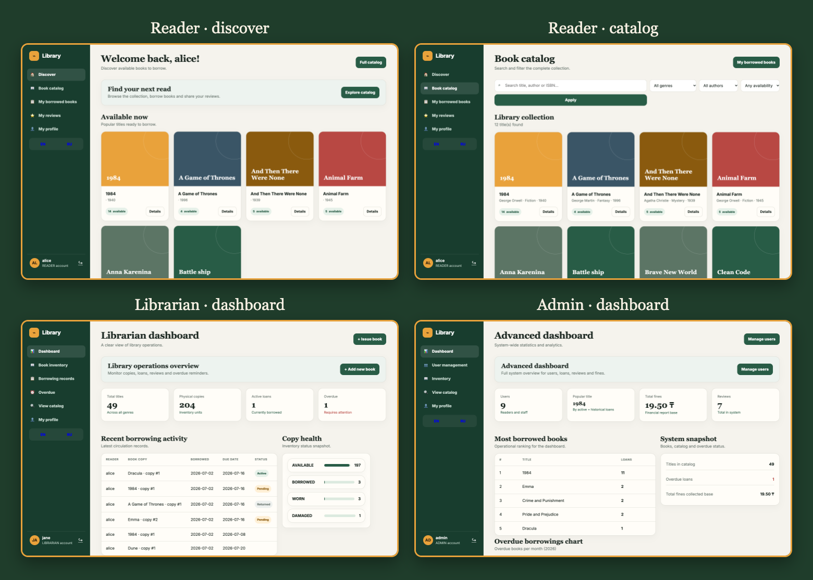
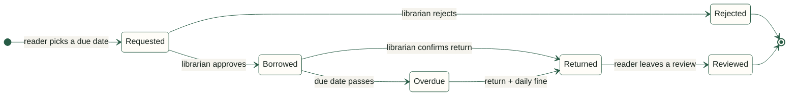
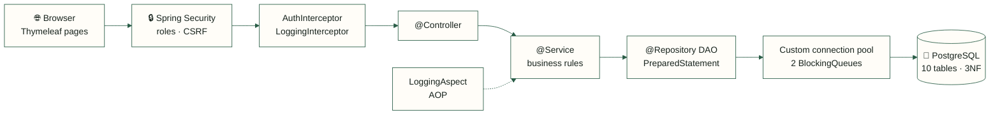

<div align="center">


# Library Management System

**A full-stack library web app with three roles: readers borrow and review books, librarians run the inventory and loans, admins see the numbers. Built on Spring MVC and plain JDBC, no Spring Boot, no ORM.**

<p align="center">
  
  
  
  
  
  
</p>

</div>

---

## 📚 What it is

A web app that covers the whole life of a library book: in the catalog, requested, approved, returned (with its
condition checked) and reviewed. Each role sees only what it needs.

| Role | What they can do |
| --- | --- |
| 📖 **Reader** | Search and filter the catalog, request a book with their own due date, track loans, write and edit reviews for books they borrowed |
| 🗂️ **Librarian** | Add, edit and delete books and copies, approve or reject requests, register returns with copy condition, track overdue loans |
| 📊 **Admin** | Analytics dashboard, manage librarian accounts, view-only catalog |

## 📸 Screenshots



## ✨ Features

- **🔎 Catalog**: search by title, author or ISBN; filter by genre, author and availability; pagination everywhere.
- **🔁 Borrowing**: up to 5 active loans, 14 days by default and never more than 60; overdue fines per day.
- **⭐ Reviews and ratings**: only readers who actually borrowed a book can review it.
- **🌐 English and Russian**: in-app language switcher (`?lang=en|ru`).
- **🔒 Security**: role-based URLs plus method-level `@PreAuthorize`, CSRF on every form, BCrypt passwords.
- **🧯 Friendly errors**: one `@ControllerAdvice` turns exceptions into a readable error page.

## 🔁 A book's journey



## 🏗️ How it's built



| Layer | Technology |
| --- | --- |
| Language | Java 11 |
| Web | Spring MVC 5, DispatcherServlet configured in code (`AppInitializer`) |
| Security | Spring Security 5, BCrypt, CSRF, `@PreAuthorize` |
| Persistence | Plain JDBC with `PreparedStatement`, PostgreSQL, custom thread-safe connection pool |
| Cross-cutting | Spring AOP (`LoggingAspect`), interceptors, Log4j2 (console + rolling file) |
| View | Thymeleaf, custom CSS, Bootstrap grid |
| Validation | JSR-303 DTOs with `@Valid`, plus HTML5 checks |
| Build and run | Maven (WAR) → Tomcat 9 via the Cargo plugin |

**Design patterns**: DAO (`BaseDAO<T, ID>` + one interface per entity), Singleton (`DatabaseConnection`,
`ConfigLoader`), Decorator (`PooledConnection.close()` returns the connection to the pool instead of closing it).
Every layer is an interface plus an implementation: Controller → Service → DAO → Database.

<details>
<summary><b>📁 Package structure</b></summary>

```
com.library
├── aspect        LoggingAspect
├── config        WebConfig, AppInitializer, SecurityConfig, SecurityWebInitializer,
│                 DatabaseConnection, ConnectionPool
├── controller    @Controller endpoints + GlobalExceptionHandler
├── dto           RegisterForm, ProfileForm (JSR-303)
├── interceptor   AuthInterceptor, LoggingInterceptor
├── model         User, Book, BookCopy, BorrowRecord, Review, Author, Genre, Publisher
├── util          ConfigLoader, PasswordUtil (BCrypt)
├── dao           BaseDAO<T,ID> + interfaces
│   └── impl      JDBC implementations
└── service       User, Book, Borrow, Review services
    └── impl
```

</details>

## 🗄️ Database

PostgreSQL, **10 tables in 3NF** with foreign keys throughout.

| Group | Tables |
| --- | --- |
| Core | `user`, `book`, `book_copy`, `borrow_record`, `review`, `author`, `genre`, `publisher` |
| Many-to-many | `book_author`, `book_genre` |
| Enum types | `user_role`, `borrow_status`, `copy_condition` |

## ✅ Tests

**82 tests** with JUnit 5 and Mockito across the service layer (books, borrowing, reviews) and the DAO layer,
with a JaCoCo coverage report. Coverage is above 50% on both the service and DAO layers.

## 🛠️ Run it

You need JDK 11+, Maven 3.6+ and PostgreSQL 12+ on `localhost:5432`. Connection settings, the pool size and the
borrowing rules live in `src/main/resources/application.properties`.

```bash
mvn clean package     # compile, test, build target/library-management.war
mvn test              # unit tests
mvn jacoco:report     # coverage → target/site/jacoco/index.html
mvn cargo:run         # download Tomcat 9 and deploy
```

Then open **http://localhost:8080/** and sign in with a demo account:

| Role | Email | Password |
| --- | --- | --- |
| Admin | `admin@lib.org` | `admin123` |
| Librarian | `jane@lib.org` | `librarian123` |
| Reader | `alice@mail.com` | `reader123` |

> Demo credentials are committed on purpose for local evaluation; this is an educational project with no production database.
> The app needs **Tomcat 9** (Servlet 3.1+): Spring 5's static resource handler calls `setContentLengthLong()`, which Tomcat 7 lacks.

<div align="center">

**Library Management System** · MIT · every book comes back 📚

</div>
